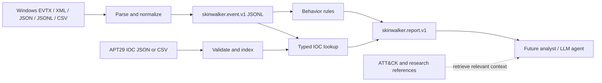

# Normalizing logs and feeding the hunting agent

See the [synthetic demo report](examples/ingestion-demo-report.json) for an example output. It contains simulated events, not an observed incident. Local workspace paths have been replaced with repository-relative paths.

This documentation commit contains the guide and sample report. Running the commands below also requires the local Skinwalker implementation and APT29 dataset.

Skinwalker now has a working offline ingestion path. The current agent is a deterministic Python hunting engine. An LLM reasoning layer and a live SIEM connector are future integrations; the new JSON report is their handoff contract.



## Three kinds of input

| Input | Purpose | How it is consumed |
| --- | --- | --- |
| Actual Windows logs | Evidence about activity on a device | Positional CLI inputs; normalized into events |
| `apt29-iocs.json` or `.csv` | rce-attributed hashes, domains, IPs, URLSous, filenames | Explicit `--iocs` argument; validated and indexed |
| ATT&CK, Sigma/Atomic inventories, PDFs, emulation plans | Explanations, technique mappings, telemetry requirements, experiment design | Analyst reference now; targeted retrieval for the future reasoning agent |

Use a directory containing **only logs** as the event input. Do not scan `data/APT29` as logs: it contains intelligence and documentation, not observations from Windows machines. The current loader accepts the normalized IOC JSON/CSV; arbitrary STIX bundles, PDF text, and reference URLs are not supported IOC feeds. The Sigma inventory is coverage metadata, not an executable rule pack.

## Run the complete pipeline

From the repository root in PowerShell, this synthetic example exercises native, Winlogbeat, and Sentinel-style events:

```powershell
python -m skinwalker examples/ingestion-events.jsonl --iocs "data/APT29/IOC Snapshot - 2026-09-18/apt29-iocs.json" --normalized-output runs/demo/events.jsonl --output runs/demo/report.json
```

Expected result: three events, one behavior finding, one historical IOC match. These are deliberately constructed test events, not a real intrusion. The engine does not contact indicator domains or IPs.

To scan real exports:

```powershell
python -m pip install -e ".[evtx]"
python -m skinwalker C:/evidence/windows --iocs "data/APT29/IOC Snapshot - 2026-09-18/apt29-iocs.json" --normalized-output runs/case-001/events.jsonl --output runs/case-001/report.json
```

Replace `C:/evidence/windows` with your log folder. Put outputs outside the input directory. Output files must be new; use another case folder for subsequent runs. `runs/` is ignored by Git so actual endpoint logs and command-line evidence are not accidentally committed.

To normalize once and process the same evidence again:

```powershell
python -m skinwalker C:/evidence/windows --normalize-only --normalized-output runs/case-002/events.jsonl --output runs/case-002/ingestion-report.json
python -m skinwalker runs/case-002/events.jsonl --iocs "data/APT29/IOC Snapshot - 2026-09-18/apt29-iocs.json" --output runs/case-002/hunt-report.json
```

`--json` also prints the report to stdout. `--fail-on-findings` returns exit code 1 for either a behavior finding or IOC hit; errors return 2, a successful scan otherwise returns 0.

## Event normalization contract

Each JSONL line is one `skinwalker.event.v1` record. Native event IDs remain integers, record IDs remain strings, and canonical searchable fields live under `data`.

| Canonical field | Examples of accepted input fields |
| --- | --- |
| `event_id` | `EventID`, `event.code`, `winlog.event_id` |
| `timestamp` | `TimeGenerated`, `TimeCreated`, `@timestamp`, Unix seconds/milliseconds |
| `computer` | `Computer`, `host.name`, `winlog.computer_name` |
| `provider`, `channel`, `record_id` | Windows System XML, Winlogbeat fields, flat export fields |
| `data.command_line` | `CommandLine`, `ScriptBlockText`, `process.command_line` |
| `data.process_name`, `data.parent_process` | `NewProcessName`, `CreatorProcessName`, `Image`, `ParentImage`, ECS process fields |
| `data.subject_user` | `SubjectUserName`, `user.name` |
| `data.source_ip`, `data.destination_ip` | `IpAddress`, `SourceIp`, `DestinationIp`, ECS source/destination IP |
| `data.destination_domain` | `QueryName`, `dns.question.name`, `destination.domain` |
| `data.url`, `data.file_name`, `data.hash_sha256` | `url.full`, `TargetFilename`, `file.hash.sha256`, Windows `Hashes` for matching |

Named values inside `data`, `EventData`, `event_data`, and `winlog.event_data` are recognized. JSON arrays, `events`/`records`/`value` envelopes, and Elasticsearch `hits.hits[]._source` are supported. Sentinel support means flat SecurityEvent row exports; raw Log Analytics `tables/columns/rows` API responses need an adapter first.

UTC offsets are converted to UTC. Naive or unparseable timestamps remain unchanged with an explicit warning; no local timezone is guessed. Missing timestamps are also flagged. Original JSON/CSV values or serialized Windows event XML are retained in `raw`; original source file and record/line position remain in `source` and `source_record`. Reports hash each input file with SHA-256. Preserve the original files and first ingestion report for forensic provenance; XML in `raw` is a serialization, not the exact original bytes.

Canonical JSONL can be replayed without repeatedly nesting fields or losing the original source. Unknown fields stay available as flattened data and in `raw`. Arrays are retained in `raw` but flattened as text; multi-valued IP/domain/hash fields require a later adapter. Malformed events fail the run with file and record/line context where available. Partial normalized output is removed; errors are not silently treated as clean results.

## IOC normalization and matching

The index defangs `[.]` and `hxxp`, normalizes domain case and trailing dots, canonicalizes IP addresses and hash case, and deduplicates lookups by `(type, value)` while preserving every source record. URLs preserve path/query case. Filenames match Windows basenames, case-insensitively.

Only dedicated observable fields are matched. The current matcher does not search all raw text, command lines, or report URLs. Domain matching is exact: a parent-domain IOC does not automatically match every subdomain. URL hostnames also participate in domain matching. Sysmon-style `Hashes=...` values can be matched through the `Hashes` field. Missing fields produce no match; they do not demonstrate that a machine is clean.

The 2026-09-18 snapshot contains 617 source records. At ingestion, one IP incorrectly tagged as a domain is corrected. Three malformed/composite domain values and two NCSC YARA strings incorrectly tagged as sample hashes are excluded with reasons. This leaves 612 accepted source records and 611 unique lookup values. The five excluded records are visible in `intel_summary.issues`; the downloaded snapshot remains unchanged. The YARA string exclusions are narrowly scoped to those two known values and source ID.

IOC source confidence describes reported intelligence, not the probability that an event is malicious. Historical entries retain their original dates and unknown active status. An exact IOC match is investigative evidence, not APT29 attribution. Shared/compromised infrastructure and generic lure filenames need context.

## Feeding a reasoning agent

The immediate agent input is `report.json`. It contains `summary`, input hashes, IOC validation issues, behavior findings with ATT&CK IDs, and IOC matches with source metadata and normalized/raw event evidence.

For a later LLM integration, group related evidence by host, account, and time window before sending it. Retrieve only the matching technique/procedure records from the ATT&CK dataset and relevant source descriptions. Ask for a structured assessment containing supporting event references, alternative benign explanations, missing telemetry, and next investigation steps. Treat every log field and retrieved document as untrusted evidence, not instructions. Set byte/token limits and review sensitive command lines before transmitting endpoint data to an external model. Do not send the entire research folder or every log line in one prompt.

The Python interface also works without the CLI:

```python
from pathlib import Path
from skinwalker.parsers import iter_events
from skinwalker.engine import hunt, load_rules
from skinwalker.intel import IntelIndex

intel = IntelIndex()
intel.load(Path("data/APT29/IOC Snapshot - 2026-09-18/apt29-iocs.json"))
rules = load_rules()
for event in iter_events(Path("runs/case-001/events.jsonl")):
    behavior_findings = hunt([event], rules)
    ioc_matches = intel.match(event)
    # Hand selected findings and event.as_dict() to your agent or storage adapter.
```

## Telemetry limits and SIEM migration

Start by checking which events and fields actually exist on the Windows devices. Process creation and command-line auditing must be configured for useful 4688 command lines; PowerShell script-block logging is another explicit collection requirement. Normalization cannot recover fields that were never logged. See [Microsoft command-line process auditing](https://learn.microsoft.com/en-us/windows-server/identity/ad-ds/manage/component-updates/command-line-process-auditing).

Most default Windows event logs will not contain the file hashes or DNS observations needed to exercise the full IOC set. Later, configured [Sysmon](https://learn.microsoft.com/en-us/sysinternals/downloads/sysmon) provides process/hash, network connection, and DNS events. Its collection configuration and the behavior rule pack still need validation against your environment.

For SIEM migration, replace the file reader with an adapter that maps incoming records into this same Event contract. Keep IOC validation and detection logic behind that boundary. Before live operation add durable storage, checkpoints, duplicate detection, bounded queues, malformed-event quarantine, source/channel-qualified rules, time-window correlation, access controls, and held-out benign/malicious evaluation. JSONL/CSV and EVTX are consumed incrementally; XML and JSON arrays currently load whole documents, and findings accumulate in memory. This is an offline prototype, not a streaming production service.

Adapter mappings were checked against [Elastic Winlogbeat fields](https://www.elastic.co/docs/reference/beats/winlogbeat/exported-fields-winlog) and [Microsoft SecurityEvent fields](https://learn.microsoft.com/en-us/azure/azure-monitor/reference/tables/securityevent).
